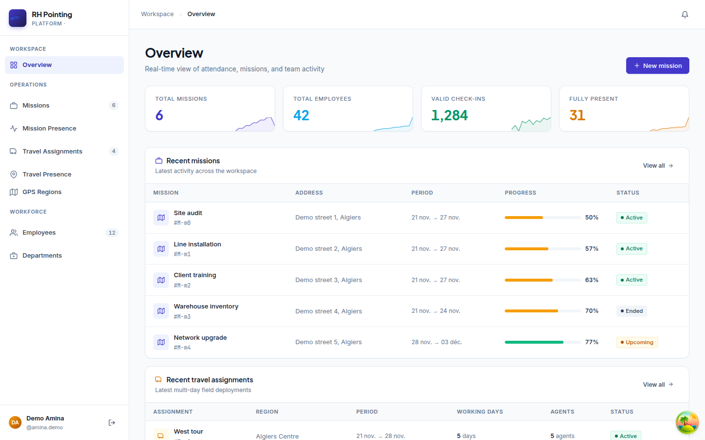
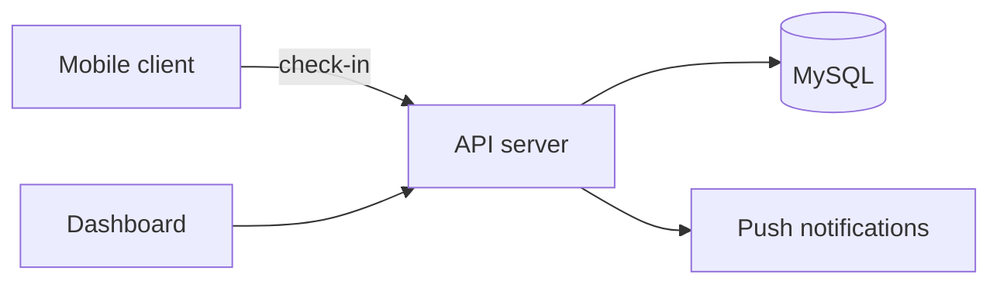
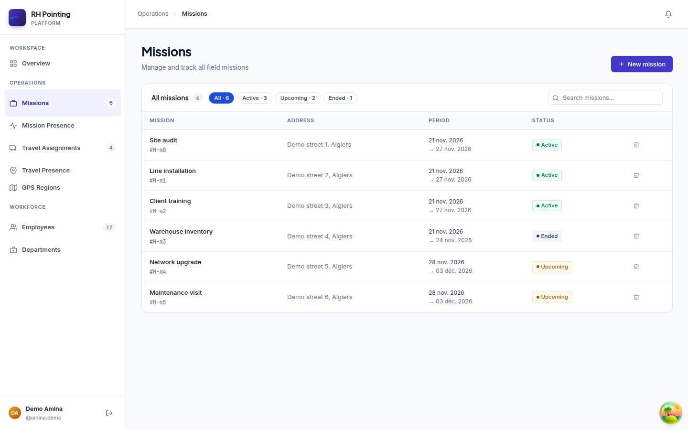
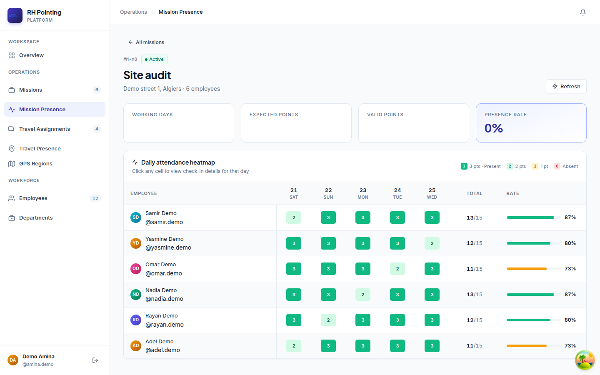
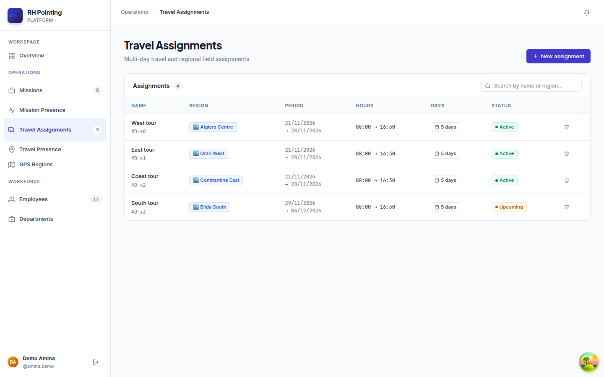
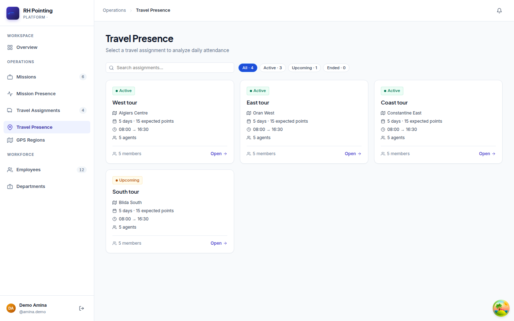
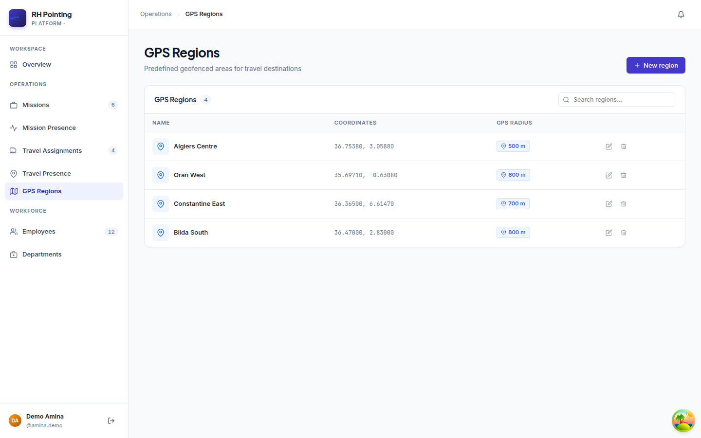
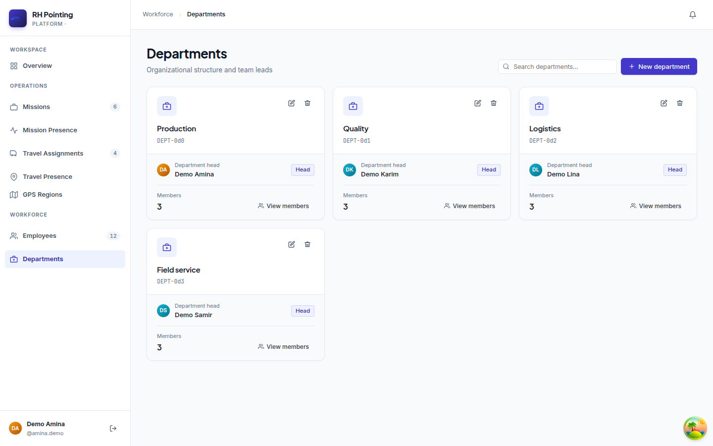
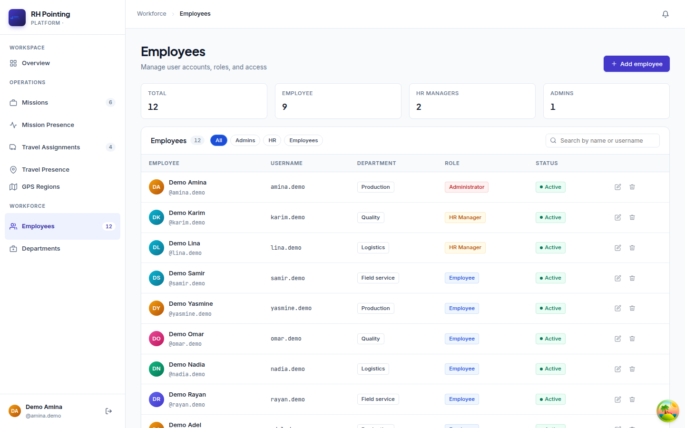
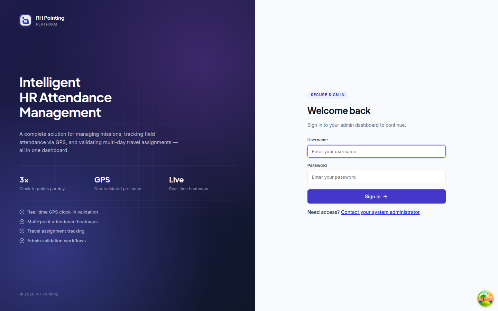

# HR Attendance Platform

Attendance for field missions and travel assignments, validated by GPS and face confirmation.

Employees check in at scheduled points during missions and multi-day assignments. The server validates distance to the expected zone, managers follow attendance as heatmaps, and notifications remind people of pending check-ins.

> **Structure only.** The source code is private. Source files here are intentionally empty so you can see how the project is organized. Commands describe the private codebase.
>
> Company names, logos and data were removed. All data in the screenshots is fictional.



## Features

- Missions with scheduled check-in points
- Multi-day travel assignments by region
- GPS radius validation and face confirmation
- Manual validation by an administrator
- Attendance rates by employee and day
- Notifications

## Applications

| Application | Role |
| --- | --- |
| [API server](server/README.md) | REST API for the dashboard and mobile clients |
| [Dashboard](dashboard/README.md) | React administration interface |

## Architecture



## Engineering highlights

- Layered modules: validator, service, controller, routes
- Unified response format and central error handling
- Environment validated at startup
- Soft deletion and structured logs

## Screenshots

| Overview | Missions |
| --- | --- |
|  |  |
| **Mission attendance** | **Travel assignments** |
|  |  |
| **Travel attendance** | **GPS regions** |
|  |  |
| **Departments** | **Employees** |
|  |  |
| **Sign in** |
|  |

Screenshots show the real dashboard connected to a mock API with fictional data, because the server needs MySQL.

## Repository layout

```text
server/                                 REST API for the dashboard and mobile clients
dashboard/                              React administration interface
docs/screenshots/
```

Each application has its own README with responsibilities, dependencies, structure and commands.

## Usage

Published for portfolio and presentation purposes. No license is granted for reuse.
