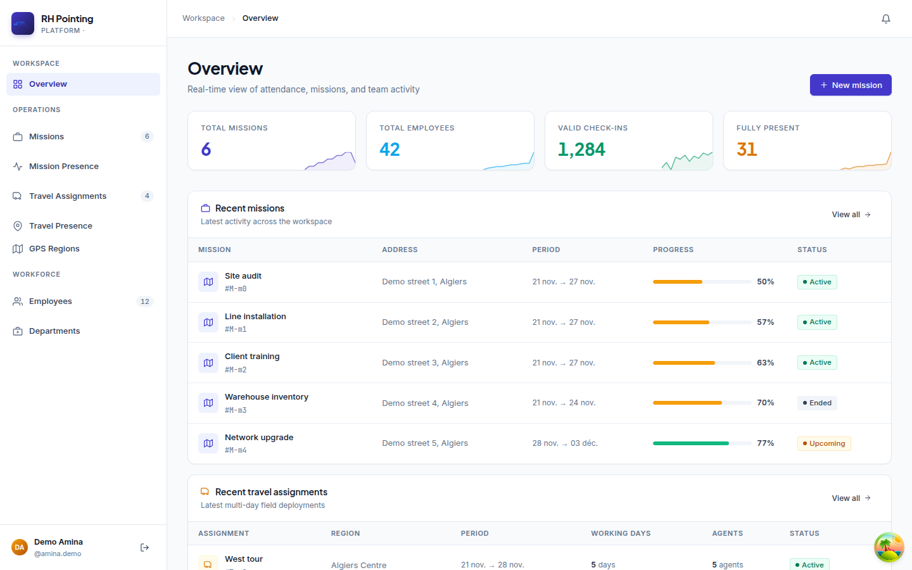
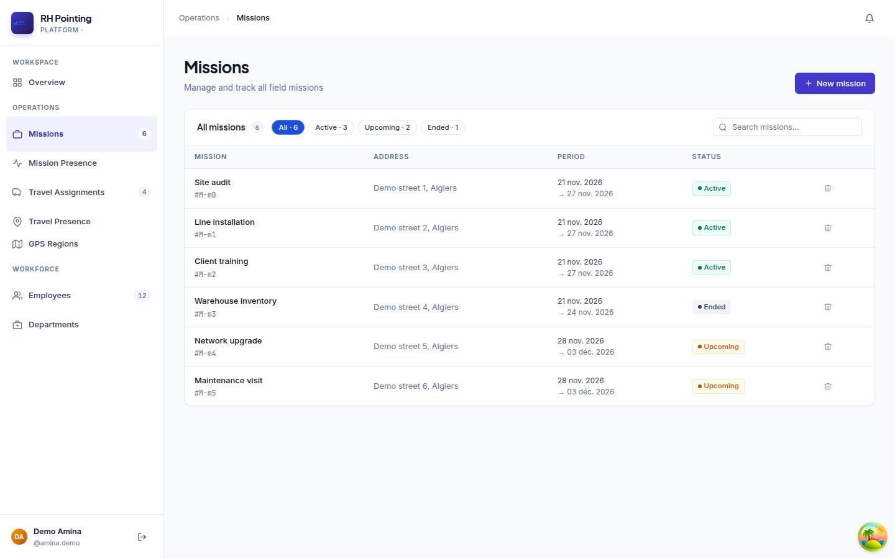
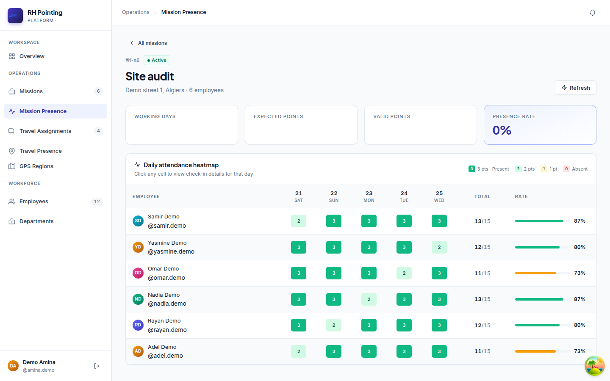
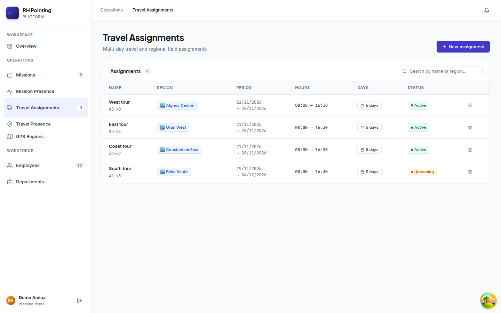
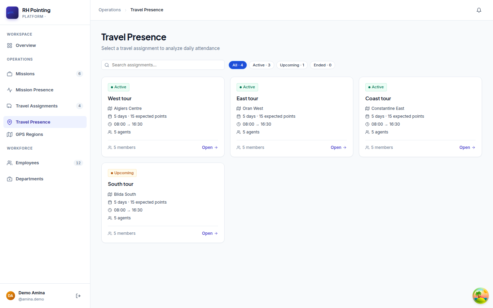
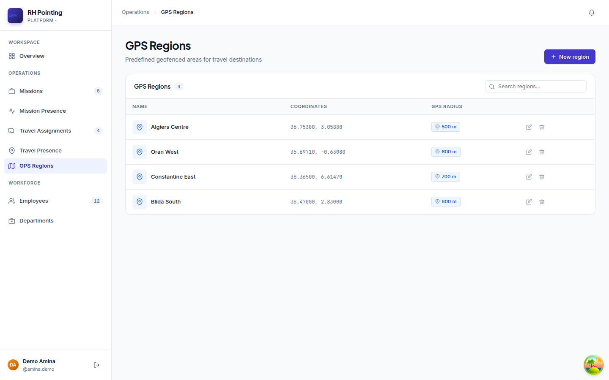
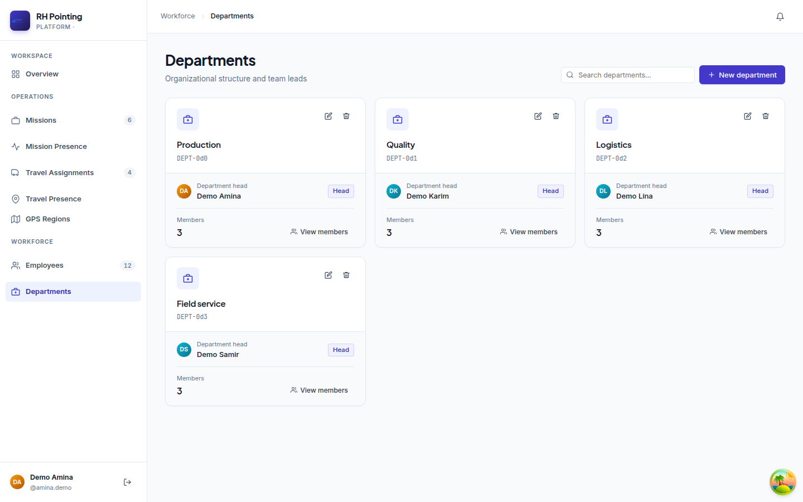
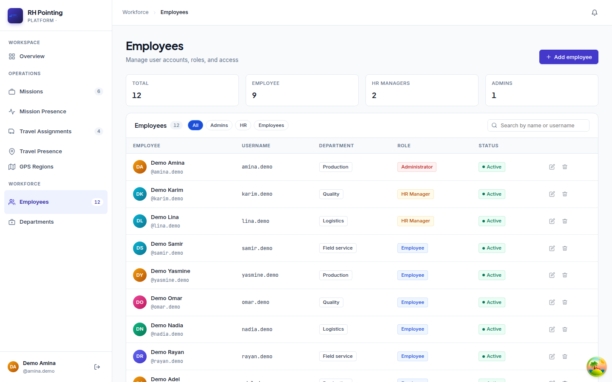
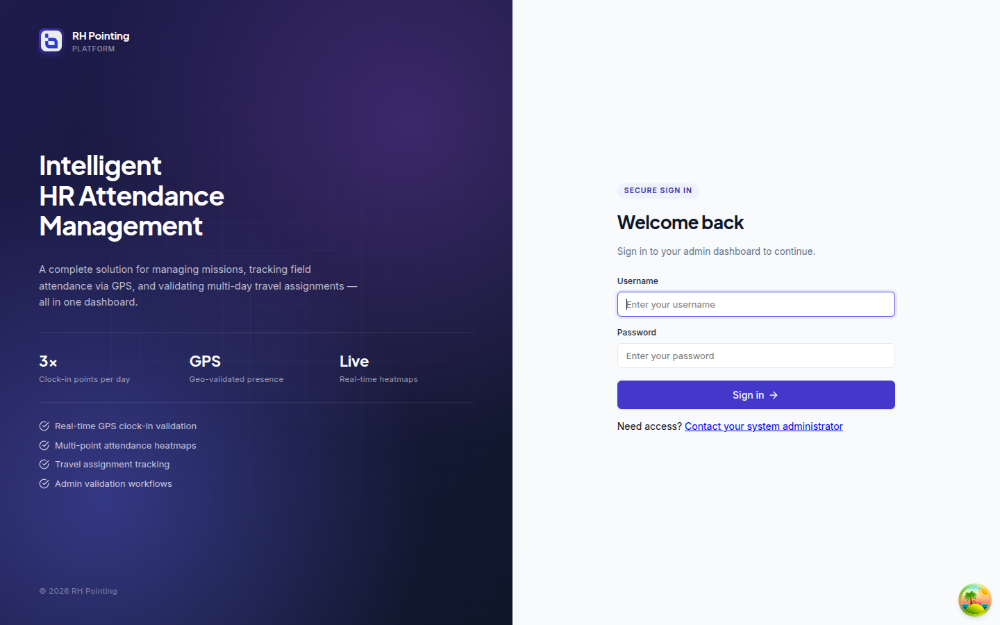

# Dashboard

React administration interface. Part of [HR Attendance Platform](../README.md).

> **Structure only.** The source code is private. Source files here are intentionally empty so you can see how the project is organized. Commands describe the private codebase.

## Responsibilities

- Overview with attendance trend
- Missions, travel assignments and GPS regions
- Daily attendance heatmaps and point details
- Departments and employees
- Map picker and route view

## Screenshots

| Overview | Missions |
| --- | --- |
|  |  |
| **Mission attendance** | **Travel assignments** |
|  |  |
| **Travel attendance** | **GPS regions** |
|  |  |
| **Departments** | **Employees** |
|  |  |
| **Sign in** |
|  |

## Main dependencies

`@tanstack/react-query`, `@tanstack/react-query-devtools`, `axios`, `leaflet`, `react`, `react-dom`, `react-router-dom`

## Structure

```text
public/                           5 files
src/                              3 files
src/api/                          2 files
src/components/                   7 files
src/context/                      1 file
src/hooks/                        1 file
src/lib/                          1 file
src/pages/                        9 files
```

## Commands

```bash
npm install
npm run dev
npm run build
```
